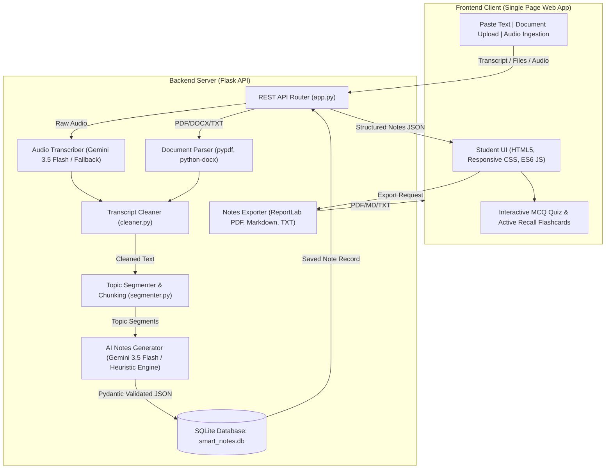

# 📚 Smart Notes Generator from Lecture Transcripts
> An AI-powered study companion that converts messy lecture transcripts and spoken audio recordings into structured, publication-grade study notes, active recall flashcards, and interactive self-quizzes.

[](https://www.python.org/)
[](https://flask.palletsprojects.com/)
[](LICENSE)
[]()

---

## 🌟 1. Project Objective & Highlights

University students and self-learners spend hundreds of hours listening to spoken lectures, often struggling to simultaneously transcribe key formulas, technical definitions, and core concepts. **Smart Notes Generator** bridges this gap:

- **Multi-Source Ingestion:** Paste transcripts directly, drag-and-drop lecture documents (**TXT, PDF, DOCX, MD**), or upload audio recordings (**MP3, WAV, M4A, WEBM, OGG**).
- **Speech-to-Text (ASR):** High-accuracy lecture audio transcription natively using **Google Gemini 3.5 Flash** multimodal audio understanding with an automatic offline demonstration fallback.
- **Smart Disfluency Cleaning:** Automatically strips verbal fillers (*"um"*, *"uh"*, *"you know"*), repetitive stuttering (*"the the"*, *"is is"*), and subtitle timestamps (*[00:12:45]*).
- **Topic Segmentation:** Intelligently splits long lectures at logical discourse transitions (*"Now let's turn to..."*, *"Moving on..."*).
- **Structured Academic Study Notes:** Strictly conforms to structured JSON including:
  - Lecture Title & Executive Overview
  - Main Topic Headings with Key Takeaways
  - Technical Term Definitions & Real-World Examples
  - Mathematical Formulas & Equations
  - Categorized Glossary
  - Concluding Summary
  - Active Recall Revision Questions & Answers (click to reveal)
  - Interactive Self-Quiz with 4-choice MCQs, instant grading, and conceptual explanations!
- **Publication-Grade Exports:** Export generated notes as formatted **ReportLab PDF**, **Markdown (.md)**, or **Plain Text (.txt)**.
- **SQLite Persistent Library:** History search, subject filters, word counts, inline editing, and deletion.

---

## 🏗️ 2. System Architecture & Workflow

### Architecture Diagram



### 9-Step Application Workflow

1. **Input Submission:** Student pastes transcript text or uploads a document/audio file.
2. **Text Extraction & Transcription:** Documents (PDF, DOCX, TXT) are parsed. Audio files are processed via Google Gemini 3.5 Flash multimodal speech-to-text.
3. **Disfluency Cleaning:** Spoken filler words (*"um"*, *"uh"*, *"you know"*), repeated words, and timestamps are stripped without losing semantic accuracy.
4. **Topic Segmentation:** Long transcripts are segmented based on linguistic transition markers to optimize context utilization.
5. **AI Synthesis:** The processed lecture is sent to Google Gemini 3.5 Flash using structured output schema (`LectureNotes`).
6. **Schema Validation:** The output JSON is rigorously validated against a Pydantic schema to guarantee consistent structure.
7. **Ground Truth Check:** Content reflects only what was taught in the lecture without synthetic hallucinations.
8. **Interactive Display:** Study notes are presented with formatted callouts, collapsible flashcards, and an auto-graded quiz.
9. **Persistence & Export:** The notes are saved to the local SQLite database and can be exported as a styled PDF, Markdown, or Plain Text.

---

## 📁 3. Folder Structure

```text
smart_notes_generator/
│
├── app.py                      # Flask application factory, server routing, error handlers
├── config.py                   # Configuration settings (environment variables, upload limits)
├── database.py                 # SQLite database schema, connections, and CRUD operations
├── requirements.txt            # Python dependencies (Flask, ReportLab, OpenAI, Pydantic, etc.)
├── .env.example                # Environment variables template
├── .env                        # Local environment configuration (API keys, ports)
├── .gitignore                  # Git ignore rules for bytecode, databases, and temporary uploads
├── README.md                   # Complete beginner-friendly documentation
│
├── services/                   # Modular backend service layer
│   ├── __init__.py             # Exposes core services
│   ├── cleaner.py              # Removes verbal fillers, stuttering, timestamps, speaker tags
│   ├── segmenter.py            # Segments transcripts using discourse transitions and length chunking
│   ├── ai_generator.py         # AI note synthesis (GPT-4o-mini / Heuristic fallback + Pydantic)
│   ├── transcriber.py          # Audio transcription via Whisper API with offline fallback
│   ├── document_parser.py      # Plain text extractor for TXT, MD, PDF (pypdf), and DOCX
│   └── exporter.py             # Publication-grade PDF (ReportLab), Markdown, and TXT exporter
│
├── static/                     # Static web assets
│   ├── css/
│   │   └── style.css           # Modern, soft-toned academic UI styling
│   └── js/
│       └── app.js              # Single-page app logic, quiz engine, inline editor, downloads
│
├── templates/
│   └── index.html              # Clean single-page application (Home, Generator, Notes, History, About)
│
├── samples/                    # Pre-loaded academic lecture transcripts for 1-click testing
│   ├── computer_science_lecture.txt  # OS: Virtual Memory, Paging, Page Faults, LRU, Belady's Anomaly
│   ├── physics_quantum_lecture.txt   # Physics: Wave-Particle Duality, Uncertainty Principle, Tunneling
│   └── biology_genetics_lecture.txt  # Biology: DNA Replication, Helicase, Polymerase, Central Dogma
│
├── tests/                      # Comprehensive automated test suite
│   ├── __init__.py
│   ├── test_cleaner.py         # Tests for transcript cleaning & filler removal
│   ├── test_segmenter.py       # Tests for topic transitions & chunking
│   ├── test_ai_generator.py    # Tests for Pydantic schema validation & fallback generation
│   ├── test_database.py        # Tests for SQLite CRUD operations & history search
│   ├── test_exporter.py        # Tests for PDF, Markdown, and TXT exports
│   └── test_api.py             # Integration tests for Flask REST endpoints
│
└── uploads/                    # Temporary storage for uploaded documents and audio files
```

---

## 💻 4. Technology Stack

| Layer | Component | Description |
| :--- | :--- | :--- |
| **Frontend** | HTML5, CSS3, ES6 JavaScript | Clean responsive Single Page Application with interactive quiz and collapsible active recall accordions. |
| **Backend** | Python 3.10+ with Flask | Lightweight, robust RESTful backend with modular service architecture. |
| **Data Validation** | Pydantic v2 | Guarantees strict JSON schema conformance for AI outputs. |
| **Database** | SQLite3 | Embedded SQL database for persistent notes storage, history search, and subject filtering. |
| **PDF Generation** | ReportLab 4.0+ | Generates publication-grade academic PDFs with custom two-pass page numbering and callouts. |
| **Document Parsing** | pypdf & python-docx | Ingests `.pdf`, `.docx`, `.txt`, and `.md` lecture documents. |
| **Speech-to-Text** | OpenAI Whisper API | High-accuracy speech recognition with local demonstration fallback for testing without credentials. |
| **AI LLM** | OpenAI GPT-4o-mini | Transforms transcripts into structured notes. Includes an offline Academic Heuristic Engine! |

---

## 🚀 5. Installation & Execution Guide

### Prerequisites
- **Python 3.10 or higher** installed on your system.
- (Optional) **OpenAI API Key** if you wish to use live GPT-4o-mini and Whisper STT.

### Step 1: Clone or Open the Project Directory
```bash
cd C:\Users\riyag\.gemini\antigravity\scratch\smart_notes_generator
```

### Step 2: (Optional) Create and Activate a Virtual Environment
```bash
# Windows
python -m venv venv
venv\Scripts\activate

# macOS / Linux
python3 -m venv venv
source venv/bin/activate
```

### Step 3: Install Required Dependencies
```bash
pip install -r requirements.txt
```

### Step 4: Configure Environment Variables
Copy `.env.example` to `.env`:
```bash
# Windows PowerShell
cp .env.example .env

# Linux / macOS
cp .env.example .env
```
Open `.env` and set your `OPENAI_API_KEY`:
```ini
OPENAI_API_KEY=sk-your-openai-api-key-here
PORT=5000
FLASK_DEBUG=True
ALLOW_OFFLINE_FALLBACK=True
```
> **Note:** If you do not have an OpenAI API key, leave it blank! The application has a built-in **Academic Heuristic Engine** that runs offline and allows you to test all features immediately.

### Step 5: Run the Application
```bash
python app.py
```
Open your web browser and navigate to:
```
http://127.0.0.1:5000
```

---

## 🧪 6. Running Automated Tests

Run the full automated test suite (cleaner, segmenter, AI schema, database CRUD, PDF exports, and REST APIs):
```bash
python -m unittest discover tests
```
Expected output:
```text
...................
----------------------------------------------------------------------
Ran 19 tests in 0.28s

OK
```

---

## 📡 7. API Reference

### 1. Generate Study Notes
- **Endpoint:** `POST /api/generate-notes`
- **Content-Type:** `application/json`
- **Request Body:**
```json
{
  "transcript": "Good morning. Today we discuss Virtual Memory...",
  "subject": "Computer Science",
  "detail_level": "medium",
  "clean_fillers": true,
  "remove_timestamps": true,
  "enable_segmentation": true
}
```
- **Response (201 Created):**
```json
{
  "note_id": 1,
  "title": "Computer Science: Virtual Memory & Paging",
  "subject": "Computer Science",
  "detail_level": "medium",
  "word_count": 850,
  "cleaning_stats": {
    "original_words": 920,
    "cleaned_words": 850,
    "reduction_percentage": 7.6,
    "fillers_removed": 14
  },
  "structured_notes": {
    "title": "Computer Science: Virtual Memory & Paging",
    "overview": "Overview of virtual memory and paging...",
    "sections": [
      {
        "heading": "Paging & Memory Management Unit",
        "key_points": ["Virtual address space is divided into 4KB pages."],
        "definitions": [
          {"term": "Page Fault", "meaning": "A trap raised when accessing an unmapped page."}
        ],
        "examples": ["Disk swap access takes 10ms vs 100ns for RAM."]
      }
    ],
    "formulas": [
      {
        "name": "Effective Access Time",
        "formula": "EAT = (1 - p) * ma + p * page_fault_time",
        "explanation": "Calculates memory access latency taking page fault rate into account."
      }
    ],
    "glossary": [
      {"term": "MMU", "meaning": "Memory Management Unit hardware"}
    ],
    "summary": "Virtual memory ensures process isolation and memory expansion.",
    "revision_questions": [
      {"question": "What is Belady's Anomaly?", "answer": "Adding more page frames causes more page faults in FIFO."}
    ],
    "mcqs": [
      {
        "question": "What is the typical page size in modern operating systems?",
        "options": ["A) 4 Kilobytes", "B) 1 Megabyte", "C) 64 Bytes", "D) 16 Gigabytes"],
        "correct_answer": "A) 4 Kilobytes",
        "explanation": "4 KB (4096 bytes) is the standard page size for x86 architecture."
      }
    ]
  }
}
```

### 2. Parse Document File
- **Endpoint:** `POST /api/upload-file`
- **Body:** `multipart/form-data` with `file: <document>` (`.txt`, `.pdf`, `.docx`, `.md`)
- **Response:** Extracted plain text string and word count.

### 3. Transcribe Audio
- **Endpoint:** `POST /api/transcribe-audio`
- **Body:** `multipart/form-data` with `audio: <recording>` (`.mp3`, `.wav`, `.m4a`, etc.)
- **Response:** Transcribed text, audio duration, and engine metadata.

### 4. Export Notes
- **Endpoint:** `GET /api/notes/<id>/export?format=pdf|markdown|txt`
- **Response:** Binary download of styled PDF, Markdown document, or Plain text file.

### 5. Notes History (CRUD)
- `GET /api/notes`: List all notes (supports `?q=search_term&subject=Physics`).
- `GET /api/notes/<id>`: Retrieve full note by ID.
- `PUT /api/notes/<id>`: Update note content or title.
- `DELETE /api/notes/<id>`: Delete note from SQLite library.

---

## 💡 8. Pre-loaded Sample Lectures

Three ready-to-use lecture transcripts are bundled in `samples/`:
1. **Computer Science:** Virtual Memory, Paging, Page Faults, EAT Formula, and Page Replacement Algorithms.
2. **Physics:** Wave-Particle Duality, Planck Relation ($E = h \cdot f$), De Broglie Wavelength, Heisenberg Uncertainty Principle, and Quantum Tunneling.
3. **Biology:** DNA Replication, Helicase, DNA Polymerase III, Okazaki Fragments, and the Central Dogma.

Click **"Try Sample Lecture"** on the home page to immediately test the end-to-end pipeline.

---

## 📤 9. Uploading to GitHub

To publish this project to your GitHub repository:

```bash
# 1. Initialize git in the project root
git init

# 2. Add all files
git add .

# 3. Commit files
git commit -m "Initial commit: Complete Smart Notes Generator web application"

# 4. Create repository on GitHub (e.g. smart-notes-generator)
# 5. Link local repository to your remote GitHub repo
git remote add origin https://github.com/<your-username>/smart-notes-generator.git

# 6. Push to main branch
git branch -M main
git push -u origin main
```

---

## 🔮 10. Future Enhancements

1. **OCR for Lecture Slides:** Extract text and diagrams from scanned lecture slides (PPTX / Images) using OpenCV and Tesseract.
2. **Multilingual Lectures:** Support translation of notes into 50+ languages with automated audio dubbing.
3. **Flashcard Anki Export:** Export revision Q&A directly into `.apkg` files for spaced repetition in Anki.
4. **Mind Map Generator:** Automatically generate Mermaid mind maps and concept graphs for visual study.
5. **Real-time Live Microphone Dictation:** Stream live classroom audio via WebSockets for real-time note taking.
